# Monitor Prometheus on Debian13


---
<p align="center">
  
</p>

## Install basic software

Install the prerequisite packages:
```bash
sudo apt install curl gnupg whois
```
## Prometheus 

### Download and install prometheus from APT:
⚠️ Not recommended, Installing via apt is not recommended for up-to-date deployments, 
as the package updates slowly(2.53). That said, if using an older version is acceptable, 
it eliminates a significant amount of manual setup
```bash
sudo apt install prometheus
```
[== Alternative Download .deb Packet ==]

🟢 You can download the last .deb package made by my repository: 
I have extracted the basic installation instructions and the service created by the official Debian APT package, 
and I have integrated them into the binaries to automatically offer the latest version,
ready for an automated installation on Debian

👉 [Download last prometheus.deb](https://github.com/xXDavisitoXx/Monitor_Prometheus_on_Debian13/releases/download/v3.12.0/prometheus_3.12.0_amd64.deb)

⚠️ If the libk fail you can check the releases in this repository:

https://github.com/xXDavisitoXx/Monitor_Prometheus_on_Debian13/releases/


### Download and install Prometheus on manual mode:
Create own user:
```bash
sudo useradd --system --no-create-home --shell /usr/sbin/nologin prometheus
```

Last version auto command:
```bash
curl -LO $( \
  curl -s https://api.github.com/repos/prometheus/prometheus/releases/latest \
  | grep "browser_download_url.*linux-amd64.tar.gz" \
  | cut -d '"' -f 4 \
)
```

static version link:
```bash
curl -LO https://github.com/prometheus/prometheus/releases/download/v3.12.0/prometheus-3.12.0.linux-amd64.tar.gz
```

Extrat tar.gz:
```bash
tar -xvf prometheus-3.11.3.linux-amd64.tar.gz
cd prometheus-3.12.0.linux-amd64
```

Copy binaries:
```bash
sudo cp prometheus /usr/local/bin/
sudo cp promtool /usr/local/bin/
```

Create directories:
```bash
sudo mkdir /etc/prometheus
sudo mkdir -p /mnt/prometheus-data/prometheus
```

Copy config file:
```bash
sudo cp prometheus.yml /etc/prometheus/
```
Restrict permissions to prometheus user:
```bash
sudo chown -R prometheus:prometheus /mnt/prometheus-data/prometheus
sudo chmod -R 750 /mnt/prometheus-data/prometheus
```

Create service:

```bash
sudo nano /etc/systemd/system/prometheus.service
```
```bash
[Unit]
Description=Prometheus Monitor Server
Documentation=https://prometheus.io/docs/introduction/overview/
Wants=network-online.target
After=network-online.target

[Service]
Type=simple
User=prometheus
Group=prometheus

ExecStartPre=/usr/local/bin/promtool check config /etc/prometheus/prometheus.yml

ExecStart=/usr/local/bin/prometheus \
  --config.file=/etc/prometheus/prometheus.yml \
  --storage.tsdb.path=/mnt/prometheus-data/prometheus \
  --web.config.file=/etc/prometheus/web.yml

Restart=on-failure
RestartSec=5s

# Seguridad
NoNewPrivileges=true
PrivateTmp=true

ProtectSystem=strict
ProtectHome=true

ProtectControlGroups=true
ProtectKernelModules=true
ProtectKernelTunables=true

LockPersonality=true
MemoryDenyWriteExecute=true
RestrictRealtime=true
RestrictNamespaces=true

# Permisos necesarios
ReadWritePaths=/mnt/prometheus-data/prometheus
ReadOnlyPaths=/etc/prometheus

# Límites
LimitNOFILE=65536

[Install]
WantedBy=multi-user.target
```
Enable and Start service:
Reaload daemon and trey start service:
```bash
sudo systemctl daemon-reload
sudo systemctl start prometheus
```

⚠️ If dont run use this command and read errors:
```bash
journalctl -xeu prometheus
sudo journalctl -u prometheus --no-pager -n 50
```

✔️ If this script dont report any errors use:
Check status:
```bash
sudo systemctl status prometheus
```
Enable service:
```bash

sudo systemctl enable prometheus
```

### Test Prometheus
Try web acces in yo browser http://YOUR-IP:9090
<p align="center">
    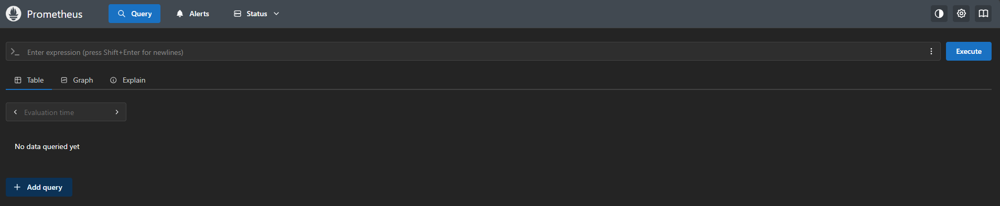
</p>

### Create prometheus user to grafana server:
Create Bcrypt password:
Example:
```bash
mkpasswd -m bcrypt grafanauser
$2b$05$FKb0e4JKCkpWI7.QZmLPs.gQnUwcYIxZJndUsermTspttT/pqkBYG
```

Insert or crearte file /etc/prometheus/web.yml:
```bash
sudo nano /etc/prometheus/web.yml
```
We will manually enter the username to be created and provide the bcrypt password generated previously
```bash
basic_auth_users:
  usergrafana: "$2y$10$xcc6l6elxJ2f0Yyed7sq/unRWgSqw/hxXLSOieZEVwnCAPH6ZPRLG"
```
Try web acces:
 - User: usergrafana
 - Pass: grafanauser
<p align="center">
    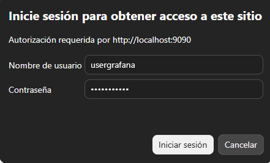
</p>

## Node-Exporter

### Install Node_Exporter
Download and install automatic from APT:
⚠️ Not recomended, using Prometheus versions provided by apt is not recommended as they are significantly outdated:

```bash
sudo apt install prometheus-node-exporter
```
== Alternative Download .deb Packet ==]

🟢 You can download the last .deb package made by my repository: 
I have extracted the basic installation instructions and the service created by the official Debian APT package, 
and I have integrated them into the binaries to automatically offer the latest version,
ready for an automated installation on Debian

👉 [Download last Node-Exporter.deb](https://github.com/xXDavisitoXx/Monitor_Prometheus_on_Debian13/releases)

⚠️ If the libk fail you can check the releases in this repository:

https://github.com/xXDavisitoXx/Monitor_Prometheus_on_Debian13/releases/

Manual mode:
Create user:
```bash
sudo useradd --system --no-create-home --shell /usr/sbin/nologin node_exporter
```

Download automatic latest command:
```bash
curl -LO $( \
  curl -s https://api.github.com/repos/prometheus/node_exporter/releases/latest \
  | grep "browser_download_url.*linux-amd64.tar.gz" \
  | cut -d '"' -f 4 \
)
```

Manual version download:
```bash
wget https://github.com/prometheus/node_exporter/releases/download/v1.10.2/node_exporter-1.10.2.linux-amd64.tar.gz
```
Descomppress:
```bash
tar xvfz node_exporter-1.10.2.linux-amd64.tar.gz
cd node_exporter-1.10.2.linux-amd64
```

Copy binaries:
```bash
sudo cp node_exporter /usr/local/bin/
```

Create service: 
```bash
sudo nano /etc/systemd/system/node_exporter.service
```

```bash
[Unit]
Description=Prometheus Node Exporter
Wants=network-online.target
After=network-online.target

[Service]
User=node_exporter
Group=node_exporter
Type=simple
ExecStart=/usr/local/bin/node_exporter

[Install]
WantedBy=multi-user.target
```
Hardened:
```bash
[Unit]
Description=Prometheus Node Exporter
Documentation=https://github.com/prometheus/node_exporter
Wants=network-online.target
After=network-online.target

[Service]
Type=simple

User=node_exporter
Group=node_exporter

ExecStart=/usr/local/bin/node_exporter \
  --web.listen-address=127.0.0.1:9100

Restart=on-failure
RestartSec=5s

# ===== Seguridad Fuerte =====
NoNewPrivileges=true
PrivateTmp=true
PrivateDevices=true

ProtectSystem=strict
ProtectHome=true

ProtectControlGroups=true
ProtectKernelModules=true
ProtectKernelTunables=true
ProtectClock=true
ProtectHostname=true

LockPersonality=true
MemoryDenyWriteExecute=true

RestrictRealtime=true
RestrictNamespaces=true
RestrictSUIDSGID=true

RemoveIPC=true

SystemCallArchitectures=native

# ===== Control de Red (Localhost Seguro) =====
IPAddressDeny=any
IPAddressAllow=127.0.0.1
IPAddressAllow=::1

# AF_NETLINK es vital para las métricas de red (dev, tcp, etc.)
RestrictAddressFamilies=AF_INET AF_INET6 AF_UNIX AF_NETLINK

# Permitir acceso a recursos de ejecución necesarios
ReadWritePaths=/run

# Capabilities vacías (No necesita privilegios de root para leer /proc)
CapabilityBoundingSet=
AmbientCapabilities=

# Limitar recursos
LimitNOFILE=65536
TasksMax=1024

[Install]
WantedBy=multi-user.target

```

Reload service:
```bash
sudo systemctl daemon-reload
```

start service:
```bash
sudo systemctl start node_exporter
```

❗If the service fail check nad resolv errors:
```bash
journalctl -xeu prometheus
sudo journalctl -u node_exporter --no-pager -n 50
```

✔️ If the service dont report any errors use:
Status service:
```bash
sudo systemctl status node_exporter
```

Enable service:
```bash
sudo systemctl enable node_exporter

```
### Test Node Exporter

Test services listen:
```bash
ss -tnlp
Active Internet connections (only servers)
Proto Recv-Q Send-Q Local Address           Foreign Address         State       PID/Program name
tcp        0      0 10.255.255.254:53       0.0.0.0:*               LISTEN      -
tcp        0      0 127.0.0.1:9100          0.0.0.0:*               LISTEN      1134/node_exporter
tcp6       0      0 :::9090                 :::*                    LISTEN      1253/prometheus
```

Test metrics in to file:
```bash
curl http://localhost:9100/metrics > metrics.txt
```

Add node_exporter server metrics to Prometheus server:
```bash
nano /etc/prometheus/prometheus.yml
```

```bash
# [=== Node Exporter Prometheus Server===]
  - job_name: "node_exporter"
    static_configs:
      - targets: ["localhost:9100"]
        labels:
          app: "node_exporter"
```
Add job to automatic targets folder:
```bash
# [=== Node Exporter Target Hosts===]
  - job_name: 'dynamic_hosts'
    file_sd_configs:
      - files:
          - '/etc/prometheus/targets/*.yml'
          - '/etc/prometheus/targets/*.json'
        refresh_interval: 5m
```

Example job Host1:
nano /etc/prometheus/targets/host1.yml
```bash
- targets:
    - '192.168.10.100:9100'  # Cambia esta IP por la del host real si no es local
  labels:
    hostname: 'host1'
    entorno: 'laboratory'
    sistema: 'debian13'
```

Restart and check the service:
```bash
sudo systemctl restart prometheus
sudo systemctl status prometheus
```
Test targets in Prometheus web:
http://YOUR-PROMETHEUS-IP:9090/targets

---
## Grafana 

### Add repository for Graana stable:
```bash
curl -fsSL https://apt.grafana.com/gpg.key \
  | gpg --dearmor \
  | sudo tee /etc/apt/keyrings/grafana.gpg > /dev/null
```

Add correct permissions to the key:
```bash
sudo chmod 644 /etc/apt/keyrings/grafana.gpg
```

Create grafana.list
```bash
echo "deb [signed-by=/etc/apt/keyrings/grafana.gpg] https://apt.grafana.com stable main" \
  | sudo tee /etc/apt/sources.list.d/grafana.list > /dev/null
```

Refresh APT:
```bash
apt update
```

### Install Grafana fron APT:
```bash
apt install grafana
```

Start service:
```bash
sudo systemctl start grafana-server
```
Enable service:
```bash
sudo systemctl enable grafana-server
```

Check status service:
```bash
sudo systemctl status grafana-server
```
### Test Grafana

Check listen service:
```bash
sudo ss -tnlp
```

```bash
Active Internet connections (only servers)
Proto Recv-Q Send-Q Local Address           Foreign Address         State       PID/Program name
tcp        0      0 127.0.0.1:9100          0.0.0.0:*               LISTEN      305/node_exporter
tcp        0      0 10.255.255.254:53       0.0.0.0:*               LISTEN      -
tcp6       0      0 :::3000                 :::*                    LISTEN      1597/grafana
tcp6       0      0 :::9090                 :::*                    LISTEN      397/prometheus
```

Enable service:
```bash
sudo systemctl enable grafana-server
```

Try web acces:

http://YOUR-IP:3000/

Default-login:
- User: admin
- Pass: admin

<p align="center">
    
</p>

Change password to grafana: 
<p align="center">
    
</p>

Grafana 
Home Dashboard:
<p align="center">
    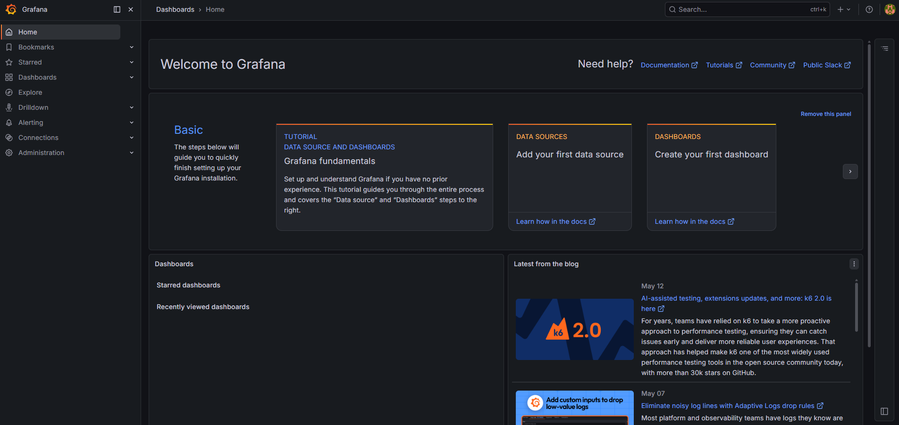
</p>

#### Add datasource Prometheus to Grafana: 
Add Prometheus to grafana data source:

Grafana_add_data_source.png
<p align="center">
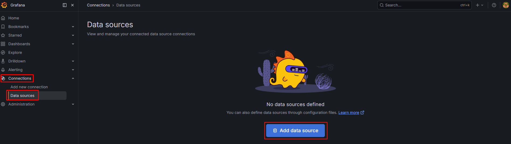
</p>

Select Promtheus source:
<p align="center">
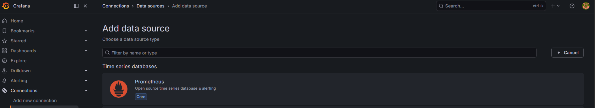
</p>

Configure autentication and IP conection address:
<p align="center">
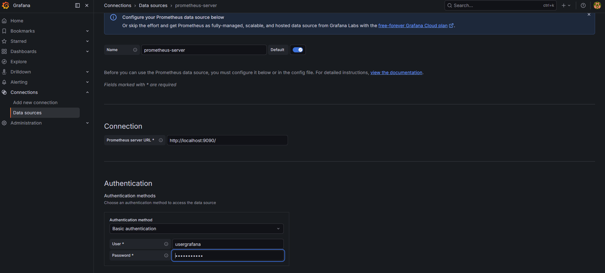
</p>

Test and verify notification:
<p align="center">
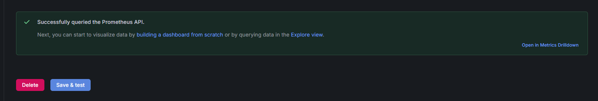
</p>

### Add Grafana dashboards

In this tutorial we use 2 dashboards:

Prometheus 2.0 Overview
https://grafana.com/grafana/dashboards/3662-prometheus-2-0-overview/
ID: 3662

Node Exporter Full
https://grafana.com/grafana/dashboards/1860-node-exporter-full/
ID: 1860

<p align="center">
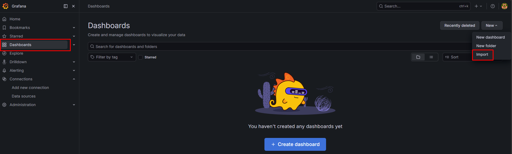
</p>

### Prometheus dashboard:

<p align="center">
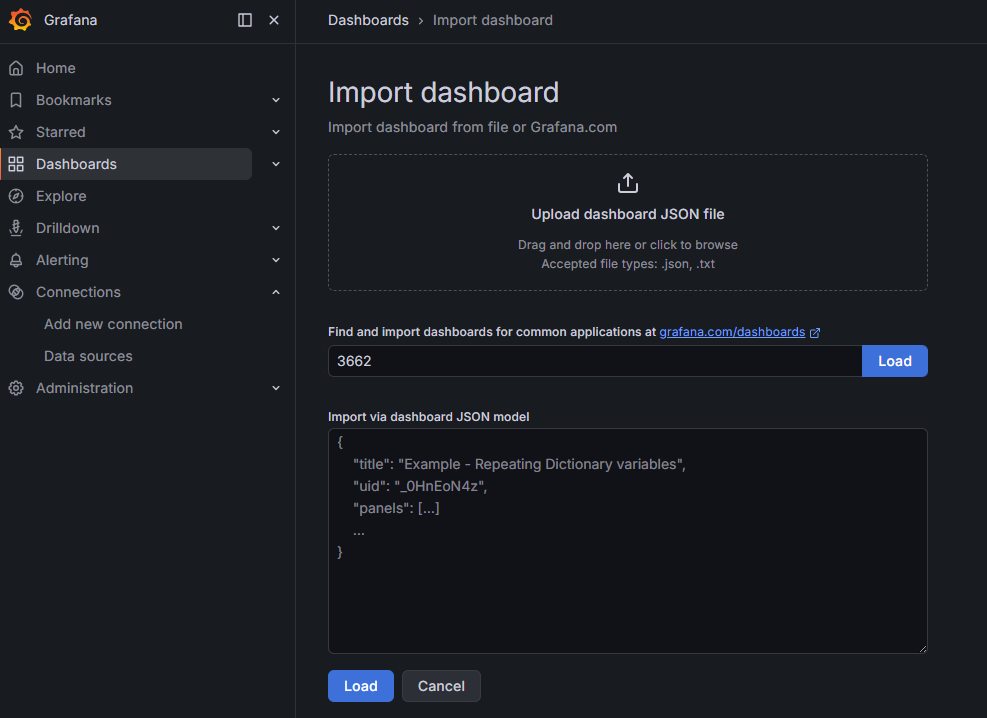
</p>


Configure name and selec to prometheus server 

<p align="center">
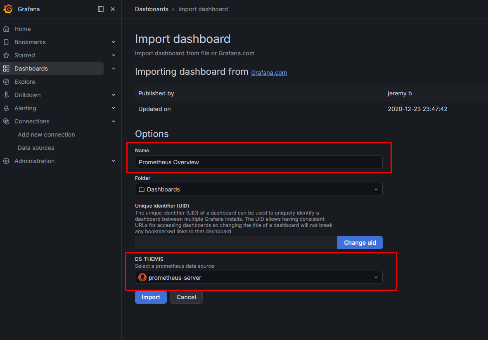
</p>

### Node Exporter Full dashboard


<p align="center">
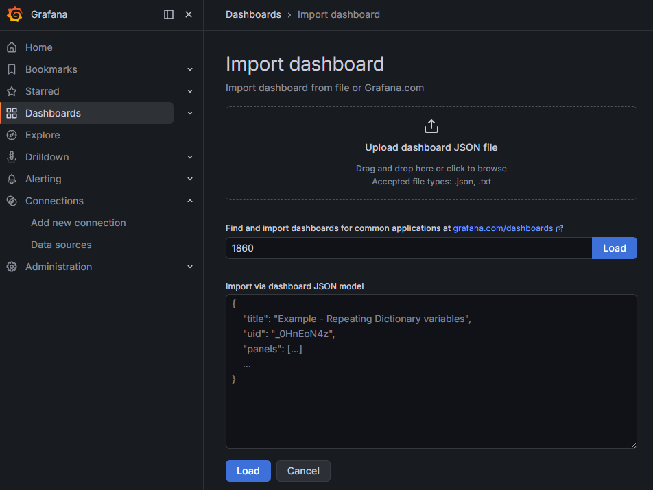
</p>
Change name and import:

<p align="center">
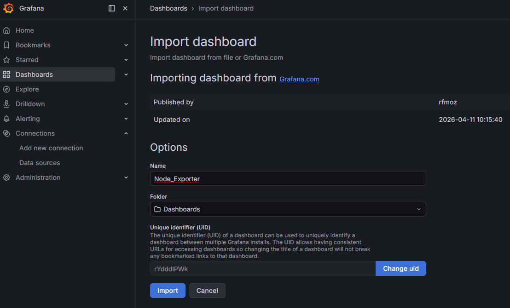
</p>


### Check dashboards
<p align="center">
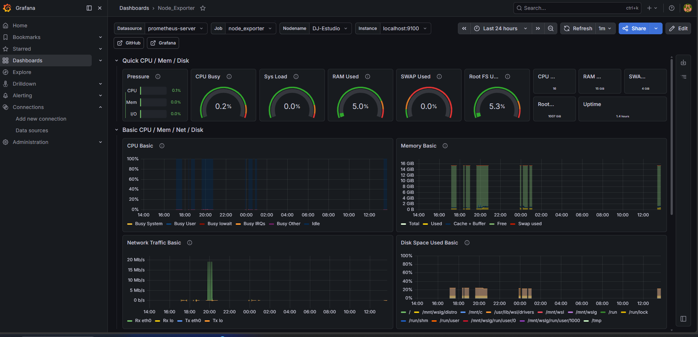
</p>

